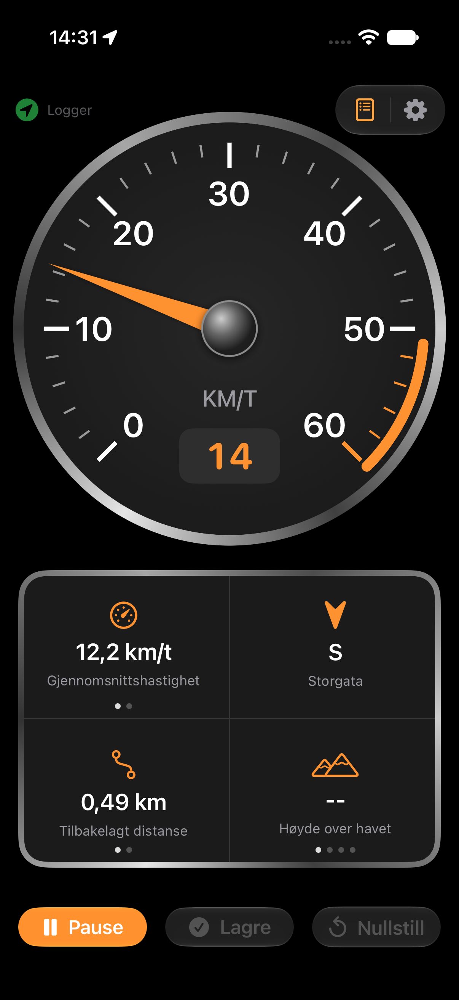
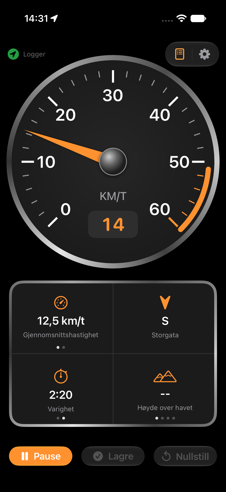
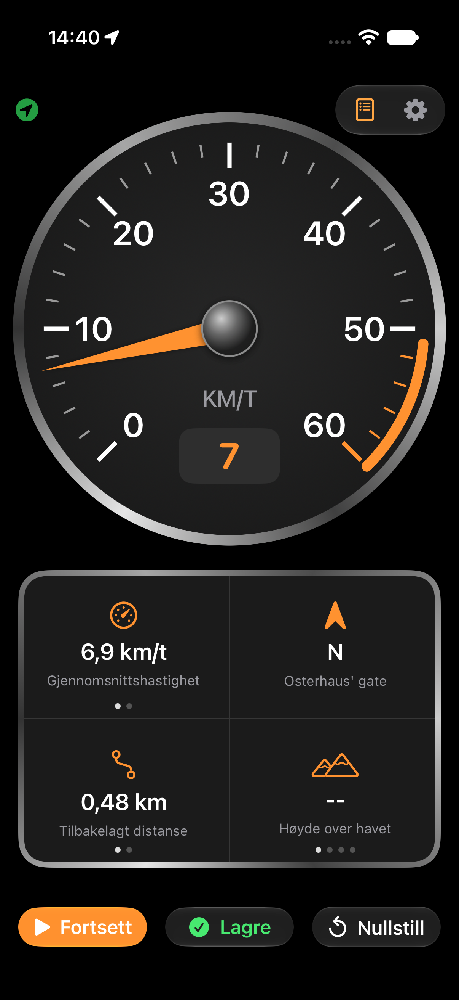
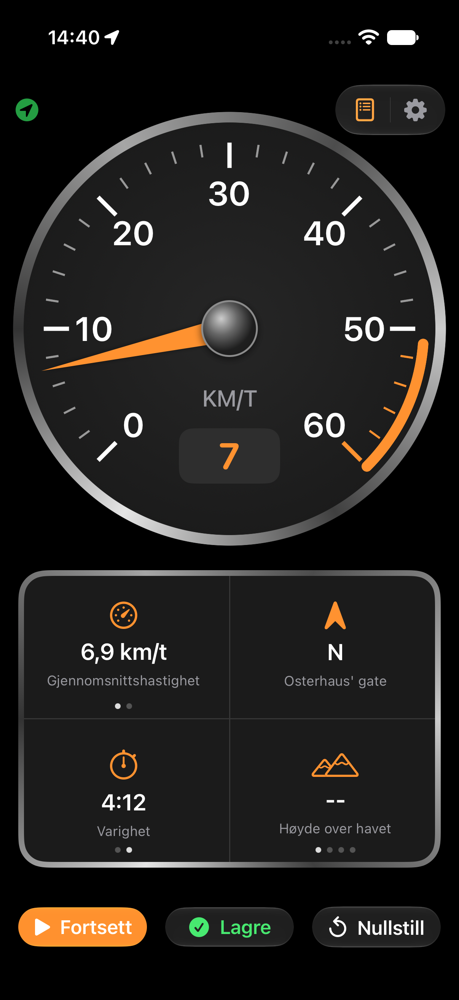
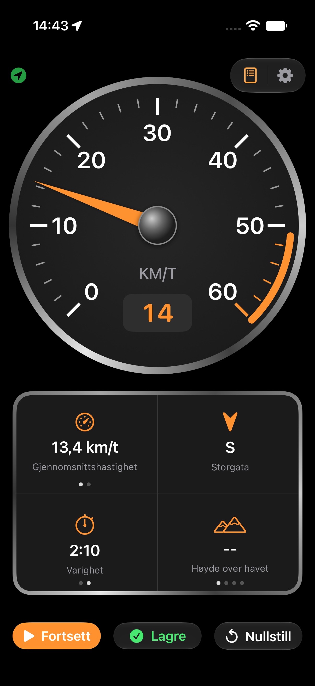

# Verifisering: lav fart gir for kort distanse (støyfilteret)

Utført 22. november 2026 på grenen `verify/slow-speed-distance`, etter `docs/handoff-lavfart-distanse.md`. Ingen produksjonskode er endret.

**Konklusjon:** Feilen finnes i iOS-appen. Med `horizontalAccuracy` på 5 m registreres **null** distanse når farten ligger under 2,5 m/s (9 km/t), og med auto-pause på er feilsonen 3–9 km/t. Ved dårligere nøyaktighet ligger gulvet høyere: 18 km/t ved hAcc 10 og 36 km/t ved hAcc 20.

## Steg 1: tester som reproduserer feilen

Begge testene ligger i `BikeSpeedTests/Services/TripManagerTests.swift` under `// MARK: - Jitter floor`.

| Test | Resultat | Målt |
|---|---|---|
| `smallStepsUnderTheJitterFloorAccumulate`: 10 × 2 m, hAcc 5 | **rød** | 0,0 m (forventet 20 ± 1 m) |
| `wanderingAroundOnePointStaysAtZero`: 10 × (+1 m, −1 m), hAcc 5, auto-pause av | grønn | 0 m |

Ellers er suiten grønn. Kjøringen hadde 200 tester i 23 suiter, og eneste feil var testen over.

## Steg 2: kartlegging av stupet

Rytteren kjører 300 m rett nordover med én måling i sekundet. Tabellen viser andelen av distansen som ble registrert. Ingen av kjøringene utløste auto-pause.

| fart (m/s) | km/t | hAcc 5 | hAcc 10 | hAcc 20 |
|---|---|---|---|---|
| 0,8 | 2,9 | 0 % | 0 % | 0 % |
| 1,0 | 3,6 | 0 % | 0 % | 0 % |
| 1,2 | 4,3 | 0 % | 0 % | 0 % |
| 1,4 | 5,0 | 0 % | 0 % | 0 % |
| 1,6 | 5,8 | 0 % | 0 % | 0 % |
| 1,8 | 6,5 | 0 % | 0 % | 0 % |
| 2,0 | 7,2 | 0 % | 0 % | 0 % |
| 2,2 | 7,9 | 0 % | 0 % | 0 % |
| 2,4 | 8,6 | 0 % | 0 % | 0 % |
| 2,6 | 9,4 | 100,1 % | 0 % | 0 % |
| 2,8 | 10,1 | 100,1 % | 0 % | 0 % |
| 3,0 | 10,8 | 100,1 % | 0 % | 0 % |
| 3,2 | 11,5 | 100,1 % | 0 % | 0 % |
| 3,4 | 12,2 | 100,1 % | 0 % | 0 % |
| 3,6 | 13,0 | 100,1 % | 0 % | 0 % |
| 3,8 | 13,7 | 100,1 % | 0 % | 0 % |
| 4,0 | 14,4 | 100,1 % | 0 % | 0 % |

Stupet ligger nøyaktig der formelen `max(1, 0,5 × hAcc)` per sekund sier:

- **hAcc 5:** gulvet er 2,5 m. Fra 2,4 til 2,6 m/s går andelen fra 0 % til 100 %. Overgangen er et stup og ikke gradvis, fordi hvert steg vurderes alene.
- **hAcc 10 og 20:** gulvet er 5 m og 10 m, som er over alle fartene i sveipet. Alt går tapt, slik formelen forutsier.

Andelen på 100,1 % skyldes avrunding i geodesien mellom testfiksturens `Fix.north` og `CLLocation.distance(from:)`. Utover det fant jeg ingen avvik.

## Steg 3: demonstrasjon i simulatoren

Oppsettet var iPhone 17-simulatoren (iOS 27.2) med en Debug-bygg. Med Xcode 27 heter Simulator-appen **Device Hub** (`Xcode.app/Contents/Applications/DeviceHub.app`). Start, Pause og Nullstill ble trykket med syntetiske museklikk.

En midlertidig `#if DEBUG`-logg i `LocationManager` viste **hAcc = 5,0 m** på alle de 452 målingene. Gulvet er derfor 2,5 m, og kjøringen med `--speed=0.9` trengtes ikke.

| Tur | Rute | Fart | Ridd under tur | Registrert | Varighet |
|---|---|---|---|---|---|
| langsom | 59.9139,10.7522 → 59.9184,10.7522 | 2 m/s (7,2 km/t) | ≈ 470 m | **0,00 km** | 4:47 |
| kontroll | samme strekning tilbake | 4 m/s (14,4 km/t) | ≈ 495 m | **0,49 km** | 2:20 |

Strekningen er ca. 500 m. Ruten ble startet noen sekunder før Start, så noen få meter falt utenfor turen. Begge varighetene omfatter også litt tid etter at ruten var ferdig, og derfor er snittfarten på skjermbildet av kontrollturen lavere enn 14,4 km/t. Under den langsomme turen skiftet gatenavnet fra Storgata til Osterhaus' gate, og 2,0 m/s lå jevnt i loggen, så appen fikk posisjonene. De ble bare aldri talt som distanse.

Under den langsomme turen ble turen ved et uhell satt på pause i ca. 8 s og deretter fortsatt. Det har ingen betydning for resultatet.

Skjermbilder:

- Langsom tur, distanse: 
- Langsom tur, varighet: 
- Kontrolltur, distanse: 
- Kontrolltur, varighet: 

## Opprydding

Den midlertidige sveipetesten (`SlowSpeedSweepTests.swift`) og debug-loggen i `LocationManager` ble fjernet etter verifiseringen.

## Rettingen (2.0.1)

Rettingen gjør det samme som Android-commit `62e912e`. I `TripManager.consume(_:)` flyttes ankeret nå bare når et steg passerer gulvet. Et steg under gulvet holder ankeret, og `teleportRejections` nullstilles fordi målingen fortsatt regnes som akseptert. Små steg summeres da til de til sammen passerer gulvet. En parkert sykkel vandrer rundt ett punkt, så avstanden fra et holdt anker passerer aldri gulvet.

### Testene etter rettingen

Begge testene fra steg 1 er grønne. Hele suiten har 199 tester, og alle er grønne.

### Sveipet etter rettingen

Rytteren kjører 300 m med én måling i sekundet, som i steg 2. Tabellen viser andelen registrert distanse.

| fart (m/s) | hAcc 5 | hAcc 10 | hAcc 20 |
|---|---|---|---|
| 0,8 | 99,3 % | 99,0 % | 97,1 % |
| 1,0 | 100,1 % | 100,1 % | 100,1 % |
| 1,2 | 99,7 % | 100,1 % | 97,3 % |
| 1,4 | 100,1 % | 99,1 % | 97,3 % |
| 1,6 | 100,1 % | 100,1 % | 96,9 % |
| 1,8 | 99,5 % | 98,9 % | 97,1 % |
| 2,0 | 100,1 % | 100,1 % | 100,1 % |
| 2,2 | 100,1 % | 99,3 % | 99,3 % |
| 2,4 | 99,3 % | 98,5 % | 100,1 % |
| 2,6 | 100,1 % | 99,2 % | 97,5 % |
| 2,8 | 100,1 % | 99,1 % | 97,3 % |
| 3,0 | 100,1 % | 100,1 % | 100,1 % |
| 3,2 | 100,1 % | 100,1 % | 98,0 % |
| 3,4 | 100,1 % | 100,1 % | 98,9 % |
| 3,6 | 100,1 % | 98,9 % | 97,7 % |
| 3,8 | 100,1 % | 98,8 % | 98,8 % |
| 4,0 | 100,1 % | 98,7 % | 100,1 % |

Stupet er borte. Det som fortsatt mangler, er resten etter siste talte steg. Den ligger under gulvet når turen slutter og blir derfor aldri talt. Den er høyst ett gulv, altså 10 m av 300 m ved hAcc 20.

### Simulatoren etter rettingen

Oppsettet og rutene var de samme som i steg 3, med hAcc 5,0 m.

| Tur | Fart | Før rettingen | Etter rettingen | Varighet etter |
|---|---|---|---|---|
| langsom | 2 m/s (7,2 km/t) | 0,00 km | **0,48 km** (snitt 6,9 km/t) | 4:12 |
| kontroll | 4 m/s (14,4 km/t) | 0,49 km | **0,49 km** | 2:10 |

Skjermbilder etter rettingen:

- Langsom tur, distanse: 
- Langsom tur, varighet: 
- Kontrolltur, distanse: 
- Kontrolltur, varighet: 
