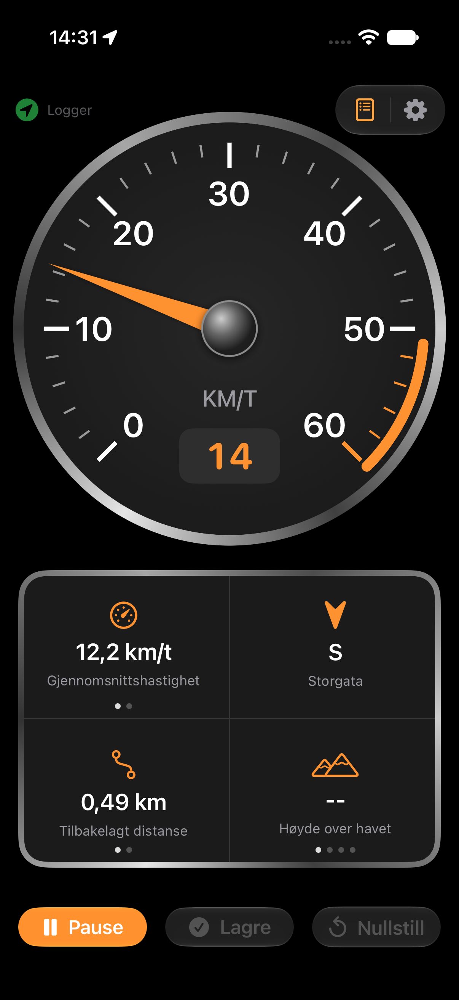
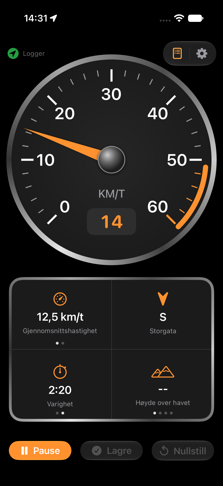
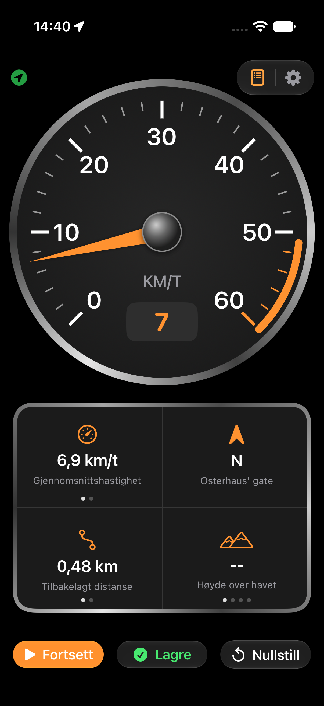
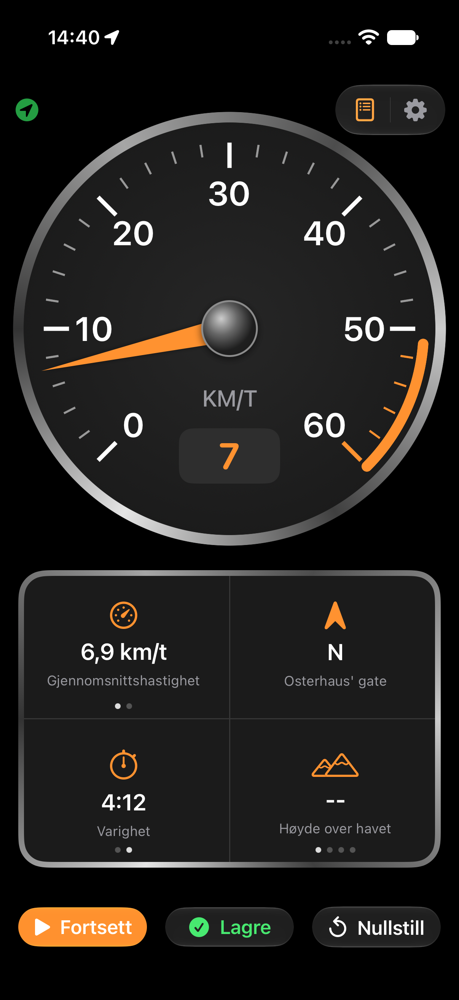
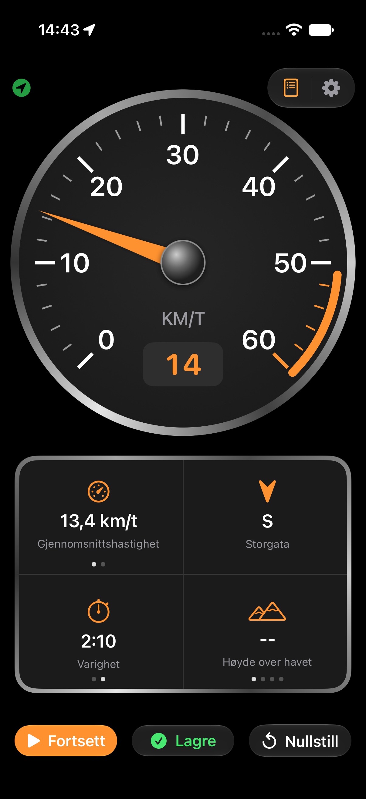

# Verification: slow riding records too little distance (the jitter floor)

Carried out on 22 November 2026, on the `verify/slow-speed-distance` branch. The verification itself changed no production code. The fix and its measurements follow in [The fix (2.0.1)](#the-fix-201).

**Conclusion:** the bug was real in the iOS app. With a `horizontalAccuracy` of 5 m, riding slower than 2.5 m/s (9 km/h) recorded **zero** distance, which with auto-pause on means 3–9 km/h. At worse accuracy the floor is higher: 18 km/h at hAcc 10 and 36 km/h at hAcc 20.

## Background

The Android port (commit `62e912e` in `klekanger/BikeSpeed-Android`, 1 August 2026) found and fixed a bug in the jitter floor that it had inherited from this code. The fix was never carried back here.

The mechanism was in `TripManager.consume(_:)`:

```swift
let advanced = delta > max(jitterFloor, 0.5 * location.horizontalAccuracy)
if advanced {
    accumulatedDistance += delta
}
anchor(on: location)   // moves the anchor even when the step was discarded
```

A step under the floor was discarded, but the anchor moved anyway. The next step was then measured from the discarded fix, not from the last one that counted. A rider covering less than the floor per fix therefore accrued **nothing**, however long they rode. Climb was hit too, because elevation sampling hangs off the same `advanced` flag.

## Step 1: tests that reproduce the bug

Both tests are in `BikeSpeedTests/Services/TripManagerTests.swift`, under `// MARK: - Jitter floor`.

| Test | Result before the fix | Measured |
|---|---|---|
| `smallStepsUnderTheJitterFloorAccumulate`: 10 × 2 m, hAcc 5 | **failing** | 0.0 m (expected 20 ± 1 m) |
| `wanderingAroundOnePointStaysAtZero`: 10 × (+1 m, −1 m), hAcc 5, auto-pause off | passing | 0 m |

The rest of the suite was green. The run had 200 tests in 23 suites, and the only failure was the test above.

## Step 2: mapping the cliff

A temporary parameterised test rode 300 m due north with one fix per second. The table shows the share of the distance that was recorded. Auto-pause never engaged.

| speed (m/s) | km/h | hAcc 5 | hAcc 10 | hAcc 20 |
|---|---|---|---|---|
| 0.8 | 2.9 | 0 % | 0 % | 0 % |
| 1.0 | 3.6 | 0 % | 0 % | 0 % |
| 1.2 | 4.3 | 0 % | 0 % | 0 % |
| 1.4 | 5.0 | 0 % | 0 % | 0 % |
| 1.6 | 5.8 | 0 % | 0 % | 0 % |
| 1.8 | 6.5 | 0 % | 0 % | 0 % |
| 2.0 | 7.2 | 0 % | 0 % | 0 % |
| 2.2 | 7.9 | 0 % | 0 % | 0 % |
| 2.4 | 8.6 | 0 % | 0 % | 0 % |
| 2.6 | 9.4 | 100.1 % | 0 % | 0 % |
| 2.8 | 10.1 | 100.1 % | 0 % | 0 % |
| 3.0 | 10.8 | 100.1 % | 0 % | 0 % |
| 3.2 | 11.5 | 100.1 % | 0 % | 0 % |
| 3.4 | 12.2 | 100.1 % | 0 % | 0 % |
| 3.6 | 13.0 | 100.1 % | 0 % | 0 % |
| 3.8 | 13.7 | 100.1 % | 0 % | 0 % |
| 4.0 | 14.4 | 100.1 % | 0 % | 0 % |

The cliff sits exactly where the formula `max(1, 0.5 × hAcc)` per second puts it:

- **hAcc 5:** the floor is 2.5 m. Between 2.4 and 2.6 m/s the share jumps from 0 % to 100 %. The change is a cliff rather than a gradual loss, because each step is judged on its own.
- **hAcc 10 and 20:** the floors are 5 m and 10 m, above every speed in the sweep. Everything is lost, as the formula predicts.

The 100.1 % comes from rounding between the test fixture's `Fix.north` and `CLLocation.distance(from:)`. I found no other deviations.

## Step 3: demonstration in the simulator

The setup was the iPhone 17 simulator (iOS 27.2) running a Debug build. In Xcode 27 the Simulator app is called **Device Hub** (`Xcode.app/Contents/Applications/DeviceHub.app`). Start, Pause and Reset were pressed with synthetic mouse clicks.

A temporary `#if DEBUG` log in `LocationManager` showed **hAcc = 5.0 m** on all 452 fixes. The floor was therefore 2.5 m, and the extra run at `--speed=0.9` was not needed.

| Trip | Route | Speed | Ridden during the trip | Recorded | Duration |
|---|---|---|---|---|---|
| slow | 59.9139,10.7522 → 59.9184,10.7522 | 2 m/s (7.2 km/h) | ≈ 470 m | **0.00 km** | 4:47 |
| control | same stretch, back | 4 m/s (14.4 km/h) | ≈ 495 m | **0.49 km** | 2:20 |

The stretch is about 500 m. Each route started a few seconds before Start, so a few metres fell outside the trip. Both durations also include some time after the route had ended, which is why the control trip's average speed in its screenshot is below 14.4 km/h. During the slow trip the street name changed from Storgata to Osterhaus' gate, and the log showed a steady 2.0 m/s, so the app was receiving the fixes. They just never counted as distance.

The slow trip was accidentally paused for about 8 s and then resumed. This does not affect the result.

Screenshots:

- Slow trip, distance: 
- Slow trip, duration: 
- Control trip, distance: 
- Control trip, duration: 

## Cleanup

The temporary sweep test (`SlowSpeedSweepTests.swift`) and the debug log in `LocationManager` were removed after the verification.

## The fix (2.0.1)

The fix does the same as Android commit `62e912e`. In `TripManager.consume(_:)` the anchor now moves only when a step clears the floor. A step under the floor holds the anchor, and `teleportRejections` is reset because the fix still counts as accepted. Small steps then add up until together they pass the floor. A parked bike's fix wanders around one point, so its distance from a held anchor never passes the floor.

### Tests after the fix

Both tests from step 1 pass. The whole suite has 199 tests, and all of them pass.

### Sweep after the fix

The rider covers 300 m with one fix per second, as in step 2. The table shows the share of the distance recorded.

| speed (m/s) | hAcc 5 | hAcc 10 | hAcc 20 |
|---|---|---|---|
| 0.8 | 99.3 % | 99.0 % | 97.1 % |
| 1.0 | 100.1 % | 100.1 % | 100.1 % |
| 1.2 | 99.7 % | 100.1 % | 97.3 % |
| 1.4 | 100.1 % | 99.1 % | 97.3 % |
| 1.6 | 100.1 % | 100.1 % | 96.9 % |
| 1.8 | 99.5 % | 98.9 % | 97.1 % |
| 2.0 | 100.1 % | 100.1 % | 100.1 % |
| 2.2 | 100.1 % | 99.3 % | 99.3 % |
| 2.4 | 99.3 % | 98.5 % | 100.1 % |
| 2.6 | 100.1 % | 99.2 % | 97.5 % |
| 2.8 | 100.1 % | 99.1 % | 97.3 % |
| 3.0 | 100.1 % | 100.1 % | 100.1 % |
| 3.2 | 100.1 % | 100.1 % | 98.0 % |
| 3.4 | 100.1 % | 100.1 % | 98.9 % |
| 3.6 | 100.1 % | 98.9 % | 97.7 % |
| 3.8 | 100.1 % | 98.8 % | 98.8 % |
| 4.0 | 100.1 % | 98.7 % | 100.1 % |

The cliff is gone. What is still missing is the remainder after the last counted step. It is under the floor when the trip ends, so it is never counted. It is at most one floor, which is 10 m of 300 m at hAcc 20.

### Simulator after the fix

The setup and routes were the same as in step 3, with hAcc 5.0 m.

| Trip | Speed | Before the fix | After the fix | Duration after |
|---|---|---|---|---|
| slow | 2 m/s (7.2 km/h) | 0.00 km | **0.48 km** (average 6.9 km/h) | 4:12 |
| control | 4 m/s (14.4 km/h) | 0.49 km | **0.49 km** | 2:10 |

Screenshots after the fix:

- Slow trip, distance: 
- Slow trip, duration: 
- Control trip, distance: 
- Control trip, duration: 

The screenshots show the app's Norwegian UI, because the simulator's device language is Norwegian.
